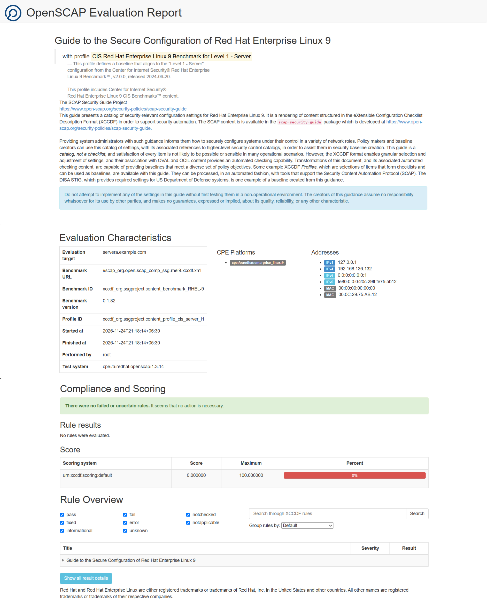

# RHEL Hardening & Compliance Automation

[](https://github.com/<As-h-ok>/rhel-hardening-ansible/actions/workflows/lint.yml)

One Ansible playbook takes a fresh RHEL 9 server to a CIS Level 1-style hardened
baseline, and an OpenSCAP scan proves the result with before/after reports.

## Results

| | Before | After |
|---|---|---|
| OpenSCAP score | **XX%** | **YY%** |
| Screenshot |  |  |

- Profile: `xccdf_org.ssgproject.content_profile_cis_server_l1`
- Datastream: `<ssg-rhel9-ds.xml | ssg-rl9-ds.xml | ssg-almalinux9-ds.xml>`
- Full HTML reports: [`scans/before/`](scans/before/) and [`scans/after/`](scans/after/)

## Stack

Ansible (roles, templates, handlers, tags) · OpenSCAP (`openscap-scanner`,
`scap-security-guide`) · auditd · firewalld · SELinux · SSH / PAM ·
chrony · dnf-automatic · Molecule (Podman) · GitHub Actions (ansible-lint)

## How it works

`site.yml` contains three plays:

```
Play 1  compliance_scan (scan_label: before)   -> install scanner, scan, download report
Play 2  hardening roles                         -> ssh, firewall, selinux, auditd, ...
Play 3  reboot, then compliance_scan (after)    -> re-scan, download report
```

The same `compliance_scan` role is reused in plays 1 and 3 with a different
`scan_label`. Each hardening role installs the package it configures and
manages one area of the system.

## Project structure

```
rhel-hardening-ansible/
├── ansible.cfg
├── site.yml                    # master playbook (3 plays)
├── requirements.yml            # collections (ansible.posix)
├── inventory/hosts.ini         # target server(s)
├── group_vars/rhel.yml         # environment-specific overrides
├── roles/
│   ├── compliance_scan/        # OpenSCAP install, scan, fetch reports
│   ├── ssh_hardening/
│   ├── firewall/
│   ├── selinux/
│   ├── auditd/
│   ├── password_policy/
│   ├── services_cleanup/
│   ├── chrony/
│   └── dnf_automatic/
├── molecule/default/           # role tests (run separately from site.yml)
├── scans/before/  scans/after/ # reports fetched from the target
├── docs/screenshots/           # score screenshots
└── .github/workflows/lint.yml  # CI: ansible-lint
```

## Requirements

- **Control node:** Linux with `ansible-core`, `git`, SSH key access to the target
- **Target node:** fresh RHEL 9 (or Rocky / AlmaLinux 9), reachable over SSH
- **Optional (tests):** Python 3 virtualenv, Podman, Molecule

## Quick start

```bash
# 1. Clone
git clone git@github.com:<your-username>/rhel-hardening-ansible.git
cd rhel-hardening-ansible

# 2. Install collections
ansible-galaxy collection install -r requirements.yml

# 3. Set your target in inventory/hosts.ini
#    target01 ansible_host=<TARGET_IP> ansible_user=root ansible_ssh_private_key_file=~/.ssh/id_ed25519

# 4. Confirm connectivity
ansible all -m ansible.builtin.ping

# 5. Run everything: before scan -> harden -> reboot -> after scan
ansible-playbook site.yml
```

Reports appear in `scans/before/` and `scans/after/`.

> **Warning:** the playbook disables SSH password login. Confirm key-based login
> works first, and snapshot the VM before the first run.

### Rocky / AlmaLinux

Set the matching datastream in `group_vars/rhel.yml`:

```yaml
scan_datastream: /usr/share/xml/scap/ssg/content/ssg-rl9-ds.xml          # Rocky
# scan_datastream: /usr/share/xml/scap/ssg/content/ssg-almalinux9-ds.xml # Alma
```

Find yours on the target with `ls /usr/share/xml/scap/ssg/content/`.

## Running selectively

Every role has a tag, and individual tasks carry the **OpenSCAP rule ID** they satisfy.

```bash
ansible-playbook site.yml --list-tags
ansible-playbook site.yml --tags scan_before                  # baseline scan only
ansible-playbook site.yml --tags ssh                          # one role
ansible-playbook site.yml --tags sshd_set_max_auth_tries      # one control
ansible-playbook site.yml --skip-tags scan_before,scan_after  # harden without scanning
ansible-playbook site.yml --check --diff                      # dry run
```

## Roles and controls

| Role | Control | Tag (OpenSCAP rule) | Why it matters |
|---|---|---|---|
| `ssh_hardening` | Root login key-only (see exceptions) | `sshd_disable_root_login` | Removes password guessing against the most-targeted account |
| `ssh_hardening` | Empty passwords disabled | `sshd_disable_empty_passwords` | Blocks accounts with no password |
| `ssh_hardening` | Max auth tries = 4 | `sshd_set_max_auth_tries` | Slows brute-force attempts |
| `ssh_hardening` | Idle timeout / keepalive | `sshd_set_idle_timeout`, `sshd_set_keepalive` | Closes abandoned sessions |
| `ssh_hardening` | X11 forwarding off | `sshd_disable_x11_forwarding` | Reduces attack surface |
| `ssh_hardening` | User environment not permitted | `sshd_do_not_permit_user_env` | Prevents environment-based bypasses |
| `ssh_hardening` | Login banner | `sshd_enable_warning_banner` | Legal notice before login |
| `ssh_hardening` | `sshd_config` mode 0600 | `file_permissions_sshd_config` | Protects the config from other users |
| `firewall` | firewalld installed, enabled | `package_firewalld_installed`, `service_firewalld_enabled` | Host-level packet filtering |
| `firewall` | Only required services allowed | (role tag `firewall`) | Default-deny posture, minimal exposure |
| `selinux` | Enforcing, targeted policy | `selinux_state`, `selinux_policytype` | Mandatory access control limits damage from a compromised service |
| `selinux` | `setroubleshoot`, `mcstrans` removed | `package_setroubleshoot_removed`, `package_mcstrans_removed` | Fewer unneeded packages |
| `auditd` | auditd installed, enabled | `package_audit_installed`, `service_auditd_enabled` | Audit trail for investigations |
| `auditd` | Identity, sudoers, login, time, MAC-policy rules | `audit_rules_identity`, `audit_rules_time`, `audit_rules_mac` | Detects tampering with accounts and security config |
| `password_policy` | Min length 14, 4 character classes | `accounts_password_pam_minlen`, `accounts_password_pam_minclass` | Stronger passwords |
| `password_policy` | Password aging | `accounts_maximum_age_login_defs`, `accounts_minimum_age_login_defs` | Forces rotation (new users only) |
| `password_policy` | Account lockout (faillock) | `accounts_passwords_pam_faillock_deny`, `accounts_passwords_pam_faillock_unlock_time` | Stops online guessing |
| `services_cleanup` | Unneeded services disabled | (role tag `services`) | Smaller attack surface |
| `services_cleanup` | Insecure packages removed (telnet, tftp, rsh, ypserv) | `package_telnet-server_removed`, `package_tftp-server_removed`, `package_ypserv_removed` | Removes legacy cleartext protocols |
| `chrony` | Time sync enabled | `package_chrony_installed`, `service_chronyd_enabled` | Reliable log timestamps |
| `dnf_automatic` | Automatic security updates | (role tag `updates`) | Patches applied without delay |
| `compliance_scan` | Before/after OpenSCAP scan | `scan_before`, `scan_after` | Evidence of the improvement |

Verify tag names against rule IDs in your own scan report, since they can differ
between SCAP Security Guide versions.

## Design decisions

1. **Each role owns its package.** Roles are self-contained and portable.
2. **Defaults in `defaults/`, environment choices in `group_vars/`.** Roles stay generic.
3. **sshd drop-in `00-hardening.conf`.** sshd uses the first value it reads, so a drop-in that sorts first overrides vendor settings such as `50-redhat.conf`.
4. **`validate: sshd -t`** checks the config before it is installed, preventing a broken sshd.
5. **Lockout `assert`.** The play refuses to run if it would cut off its own SSH connection.
6. **Tags mirror OpenSCAP rule IDs**, so code maps directly to scan evidence.
7. **Handlers** restart services only when a config actually changed.
8. **Idempotent by design.** A second run of the hardening roles should report `changed=0`.

## Testing

Three independent checks:

| Tool | Question | Runs against |
|---|---|---|
| OpenSCAP scan | Is the real server compliant? | Target VM |
| Molecule | Does the role work and stay idempotent? | Disposable container |
| ansible-lint (GitHub Actions) | Is the code clean on every push? | Repository |

### Molecule

Molecule covers `ssh_hardening`, `password_policy` and `services_cleanup`.
SELinux, auditd and firewalld depend on the host kernel, so containers cannot
test them honestly. They are verified by the OpenSCAP scan on a real VM.

```bash
python3 -m venv .venv
source .venv/bin/activate
pip install molecule "molecule-plugins[podman]" ansible-core ansible-lint yamllint
ansible-galaxy collection install containers.podman ansible.posix

molecule test        # create, prepare, converge, idempotence, verify, destroy
molecule converge    # apply roles and keep the container
molecule login       # shell inside the container
molecule destroy
```

### Idempotency check

```bash
ansible-playbook site.yml --skip-tags scan_before,scan_after   # run twice
# second run should show changed=0
```

`compliance_scan` writes new reports every time, so it is excluded here.

## Known exceptions

Controls that deliberately fail or cannot be automated after installation:

| Rule | Status | Reason |
|---|---|---|
| `sshd_disable_root_login` | Fails (intentional) | Ansible connects as root. Login is key-only (`PermitRootLogin prohibit-password`). Production setups should use an admin user with sudo instead. |
| Separate `/tmp`, `/var`, `/var/log/audit` partitions | Not automated | Requires partitioning at install time |
| GRUB bootloader password | Not automated | Needs interactive secrets and bootloader changes |
| `<add others from your after-report>` | | |

## Lessons learned

- sshd reads the **first** value of each option, so ordering of drop-in files matters.
- Validate configs before installing them (`sshd -t`) to avoid lockouts.
- `command` tasks need `changed_when`, or idempotency checks fail.
- `login.defs` password aging affects only newly created users; existing users need `chage`.
- A 100% score is not realistic after install; documenting exceptions is part of the job.

## Disclaimer

Run this only on systems you own or are authorised to change. Test on a snapshot
first. This project is a learning and portfolio exercise and does not replace a
full CIS or organisational compliance program.

## License

MIT, see [LICENSE](LICENSE).
